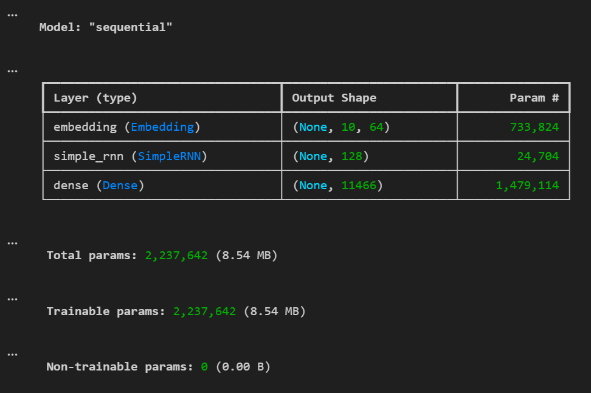

# Next-Word Prediction Using Vanilla RNN

# -- Screenshot


## Project Overview
This project uses a Vanilla Recurrent Neural Network (SimpleRNN) built with TensorFlow to predict the next token from the Tiny Shakespeare dataset. The model generates three consecutive tokens from a given input sentence.

## Technologies Used
- Python
- TensorFlow / Keras
- NumPy
- Regular Expressions (`re`)
- Jupyter Notebook

## Dataset
The project uses the Tiny Shakespeare text dataset.

Dataset source: [Tiny Shakespeare](https://raw.githubusercontent.com/karpathy/char-rnn/master/data/tinyshakespeare/input.txt)

The notebook downloads the dataset as `data.txt` if it is not already present.

## Project Workflow
1. Download and inspect the dataset.
2. Convert the text to lowercase and normalize whitespace.
3. Tokenize words and punctuation.
4. Create the vocabulary and token-to-ID mappings.
5. Prepare input sequences of 10 tokens and their next-token targets.
6. Split the sequences into 90% training data and 10% validation data.
7. Build a model using an Embedding layer, SimpleRNN layer, and Dense Softmax output layer.
8. Compile and train the model for 5 epochs using the CPU.
9. Generate the next three tokens autoregressively.
10. Experiment with token-probability inspection, greedy decoding, and top-k sampling.

## Model Architecture
- **Embedding:** Converts token IDs into dense vectors of size 64.
- **SimpleRNN:** Learns sequential patterns using 128 units.
- **Dense + Softmax:** Produces probabilities for tokens in the vocabulary.

## Model Performance

| Metric | Result |
|---|---:|
| Training Loss | 4.4349 |
| Validation Loss | 5.5768 |
| Training Accuracy | 19.96% |
| Validation Accuracy | 15.55% |

Validation accuracy measures how often the model's highest-probability next-token prediction matched the correct token in the validation set. It does not measure the overall grammatical quality of generated text.

## Experiments and Results

### 1. Top-5 Probability Analysis
Inspected the five most probable next tokens for an example input. The full stop (`.`) had the highest probability at approximately 25.97%, explaining why greedy decoding selected it first for that input.

### 2. Greedy Decoding
The model repeatedly selected the token with the highest probability to generate three consecutive tokens.

Example output:
```text
the king was standing in front of the great castle . gremio :
```

### 3. Top-k Sampling
Added temperature scaling (`temperature=0.8`) and top-k sampling (`top_k=10`) to select from likely candidate tokens. This produced varied outputs across attempts, although the generated sequences were not always coherent.

## Final Conclusion
The project demonstrates next-token prediction and autoregressive text generation with a CPU-based Vanilla RNN. The experiments show how token probabilities and decoding strategies affect the output. The model learned some patterns from the dataset, but its validation accuracy and generated text indicate that there is room for improvement.

## Project Files
- `rnn.ipynb` — notebook containing preprocessing, training, prediction, and experiments.
- `data.txt` — downloaded Tiny Shakespeare dataset.
- `README.md` — project documentation.

## How to Run
1. Install Python and the required libraries.
2. Open `rnn.ipynb` in Jupyter Notebook.
3. Run the cells in order. The notebook downloads `data.txt` if it is missing.
